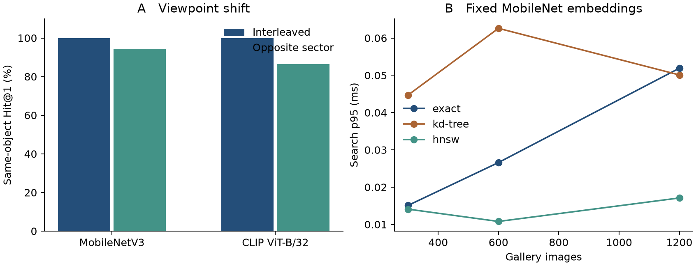
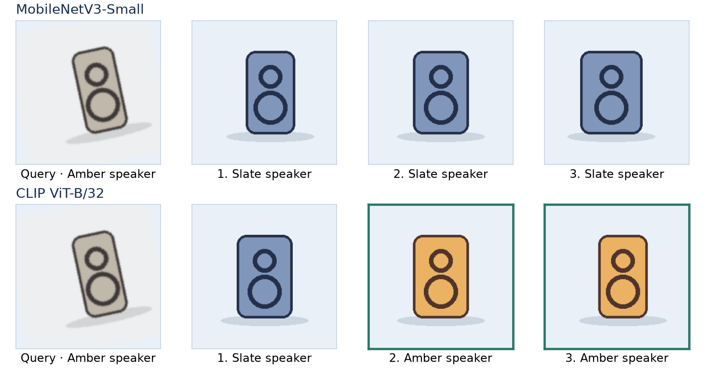

# Visual Search & Retrieval Benchmark


Compare exact cosine search with approximate candidate retrieval on real Fashion-MNIST images. The [interactive portfolio demo](https://martaforjaz.github.io/visual-search/) lets you switch methods on held-out queries and inspect mismatched results. The local demo also accepts image uploads.

## Results

300 held-out queries searched nested galleries of 1,000, 5,000 and 12,000 images. At 12,000 images, exact cosine search took **0.8675 ms p95**. Retrieving and reranking 128 candidates cut p95 to **0.1964 ms** with **75.0% Recall@10**. Using 512 candidates recovered **90.27%** of the exact neighbors at **0.7673 ms p95**. Same-class Precision@10 was **77.93%** for 512 candidates and **78.17%** for exact search. At 1,000 images, exact was faster than all tested approximate configurations.

The 12,000-image approximate index stored about **28.10 MiB** versus **26.37 MiB** for exact search. This estimate adds the float32 vectors, projection matrix and serialized tree for approximate search. It measures storage footprint, excluding process overhead and temporary allocations. Latency is single-threaded local CPU search time and includes projection and reranking where applicable. It excludes image encoding and network time. These figures describe this run on this hardware.

## Method

ImageNet-pretrained MobileNetV3-Small produces 576-dimensional, L2-normalized pooled features. Exact search ranks by dot product. The approximate method uses a seeded 16-dimensional Gaussian projection and a KD-tree to shortlist candidates, then reranks in the original feature space. Recall@10 measures overlap with exact neighbors, and same-class Precision@10 compares Fashion-MNIST labels. Class agreement is a coarse proxy for usefulness. The hard example in the demo shows how even exact search can retrieve the wrong class.

## Reproduce

Use Python 3.12+, install compatible PyTorch and torchvision versions, then run:

```sh
pip install torch==2.11.0 torchvision==0.26.0 --index-url https://download.pytorch.org/whl/cpu
pip install -r requirements.txt
python benchmark.py
python serve.py
```

Open http://127.0.0.1:8777 to upload an image. Inputs are converted to 28×28 grayscale to match the dataset. The hosted demo uses saved results. The benchmark writes [results.json](results.json) and asserts at least **0.88 Recall@10** and at most a **3-point same-class precision drop** at 12,000 images with 512 candidates. GitHub Actions runs the benchmark on CPU.

Data and thumbnails are from [Zalando Research Fashion-MNIST](https://github.com/zalandoresearch/fashion-mnist). Pretrained weights are from [Torchvision](https://docs.pytorch.org/vision/stable/models/generated/torchvision.models.mobilenet_v3_small.html).

## Product search

[Open the live product search](https://martaforjaz.github.io/product-search/). Select a held-out illustration or upload a photo to run MobileNetV3 and exact cosine ranking directly in the browser. The gallery has 24 views of eight original illustrated products, and known matches are marked for sample queries. The uploaded image stays in the browser. This small catalog demonstrates the interaction; it is separate from the real-image benchmark.



### Real-image evaluation

We used [Columbia COIL-100](https://www.cs.columbia.edu/CAVE/software/softlib/coil-100.php) because it supplies known object identities and controlled viewpoints. Of 7,200 photographs, 600 held-out views were searched against nested 300, 600 and 1,200-image galleries. An additional comparison used 1,300 queries from the opposite angular sector. In that harder split, MobileNetV3-Small achieved **94.46% Hit@1 and 98.54% Hit@10**, while CLIP ViT-B/32 achieved **86.46% and 92.08%**. Each metric checks whether at least one result belongs to the same physical object. The controlled studio background limits what these results say about consumer photos.

With MobileNet embeddings fixed and the gallery at 1,200 images, exact Faiss search took **0.0519 ms p95**, projected KD-tree took **0.0501 ms**, and HNSW took **0.0171 ms**. HNSW recovered **99.97%** of exact top-10 neighbors and the KD-tree recovered **97.78%**. All three found the correct object in their top ten for every interleaved query at that size. These single-threaded local query measurements exclude encoding. [Raw benchmark](catalog-results.json).

### Local catalog API

The loopback API supports binary image uploads to POST /search and idempotent writes to POST /products/{product}/views/{view}. SQLite holds vectors across restarts; each committed write publishes a rebuilt in-memory exact-search snapshot. The test sends 40 searches without writes and 40 while inserting ten views. End-to-end p95 was **24.78 ms** and **19.82 ms** respectively in this run. The lower number under updates is descriptive and should not be interpreted as a speedup. Encoding p95 was **22.31 ms** and **17.55 ms**. The test also verified that 12 concurrent identical writes created one row, a conflicting payload returned HTTP 409, and the inserted view remained searchable after reopening the service. [Raw load results](catalog-load.json).

### Reproduce product search

Install the main requirements and requirements-catalog.txt after PyTorch. Download the official COIL-100 processed archive to cache/coil100.zip. No original COIL images are committed.

```sh
python catalog_benchmark.py
python catalog_load.py
python build_product_demo.py
python plot_catalog.py
python -m http.server 8779 --directory product-site
```

Run python catalog_api.py to start the local API. The browser demo loads ONNX Runtime Web; it uses a local ONNX model exported from [Torchvision MobileNetV3-Small](https://docs.pytorch.org/vision/stable/models/generated/torchvision.models.mobilenet_v3_small.html).
### One query, two models



Both encoders ranked a slate speaker first when given the altered amber-speaker illustration. CLIP recovered the correct product at ranks 2 and 3. MobileNet returned three views of the wrong product. Green outlines mark the correct product. The example was selected from 32 original and transformed queries for its same-category mismatch.

[See the side-by-side comparison](https://martaforjaz.github.io/product-search/#compare-heading). It shows recorded exact rankings on the illustrated catalog. The graph underneath uses the separate COIL-100 experiment to isolate index recall and latency at 1,200 images. Run python compare_demo.py after building the browser catalog to regenerate the comparison.
