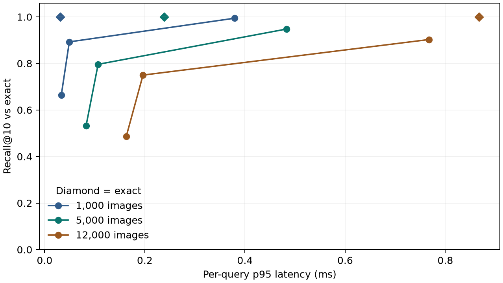

# Visual Search & Retrieval Benchmark



Compare exact cosine search with approximate candidate retrieval on real Fashion-MNIST images. The [interactive portfolio demo](https://martaforjaz.github.io/visual-search/) lets you switch methods on held-out queries and inspect mismatched results. The local demo also accepts image uploads.

## Results

300 held-out queries searched nested galleries of 1,000, 5,000 and 12,000 images. At 12,000 images, exact cosine search took **0.8675 ms p95**. Retrieving and reranking 128 candidates cut p95 to **0.1964 ms** with **75.0% Recall@10**. Using 512 candidates recovered **90.27%** of the exact neighbors at **0.7673 ms p95**. Same-class Precision@10 was **77.93%** for 512 candidates and **78.17%** for exact search. At 1,000 images, exact was faster than all tested approximate configurations.

The 12,000-image approximate index stored about **28.10 MiB** versus **26.37 MiB** for exact search. This estimate adds the float32 vectors, projection matrix and serialized tree for approximate search. It measures storage footprint, excluding process overhead and temporary allocations. Latency is single-threaded local CPU search time and includes projection and reranking where applicable. It excludes image encoding and network time. These figures describe this run on this hardware.

## Method

ImageNet-pretrained MobileNetV3-Small produces 576-dimensional, L2-normalized pooled features. Exact search ranks by dot product. The approximate method uses a seeded 16-dimensional Gaussian projection and a KD-tree to shortlist candidates, then reranks in the original feature space. Recall@10 measures overlap with exact neighbors, and same-class Precision@10 compares Fashion-MNIST labels. Class agreement is a coarse proxy for usefulness. The hard example in the demo shows how even exact search can retrieve the wrong class.

## Reproduce

Use Python 3.12+, install compatible PyTorch and torchvision versions, then run:

```sh
pip install torch==2.11.0 torchvision==0.26.0 --index-url https://download.pytorch.org/whl/cpu
pip install -r requirements.txt
python benchmark.py
python serve.py
```

Open http://127.0.0.1:8777 to upload an image. Inputs are converted to 28×28 grayscale to match the dataset. The hosted demo uses saved results. The benchmark writes [results.json](results.json) and asserts at least **0.88 Recall@10** and at most a **3-point same-class precision drop** at 12,000 images with 512 candidates. GitHub Actions runs the benchmark on CPU.

Data and thumbnails are from [Zalando Research Fashion-MNIST](https://github.com/zalandoresearch/fashion-mnist). Pretrained weights are from [Torchvision](https://docs.pytorch.org/vision/stable/models/generated/torchvision.models.mobilenet_v3_small.html).
